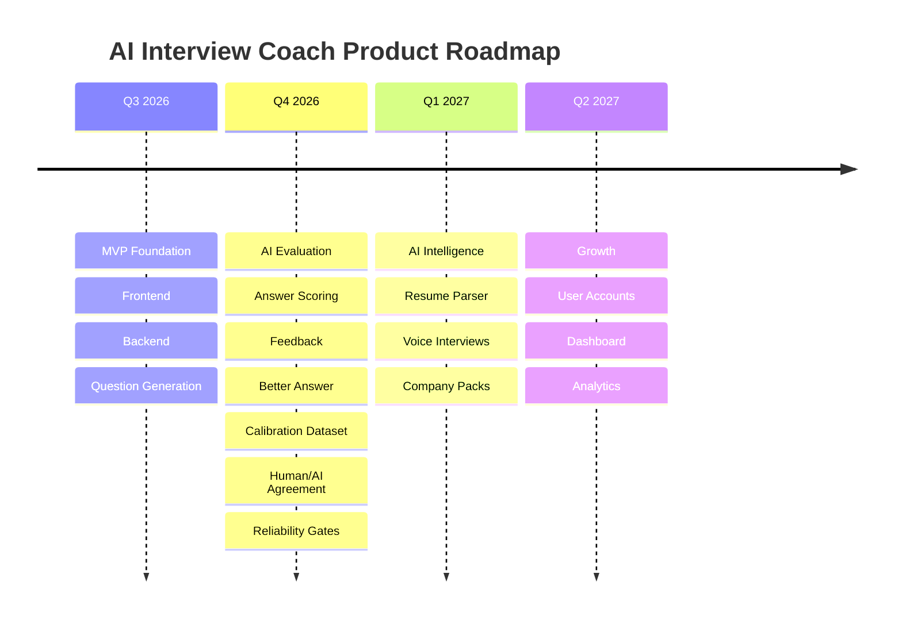

# Product Roadmap

**Product:** AI Interview Coach

**Owner:** AI First Product Manager

**Document Version:** 1.0

**Status:** Active

---

# Product Vision

Build the leading AI-powered interview preparation platform for Product Managers by combining personalized interview generation, explainable AI evaluation, and measurable improvement.

---

# Roadmap Timeline

---

# Phase 1 — MVP Foundation ✅

Objectives

- Project setup
- Frontend
- Backend
- API integration
- Service layer
- Mock interview generation

Status

Completed

---

# Phase 2 — AI Coaching

Objectives

- Submit answer
- AI evaluation
- Structured scoring
- Better answer generation
- Interview summary
- Human-rated calibration dataset
- Prompt/model versioning
- Evaluation confidence and guardrails
- Optional learning guidance: actionable improvement suggestions and an evidence-grounded illustrative stronger answer
- Provider error handling and observability

Success Metric

Average interview score improvement, with human/AI adjacent agreement ≥80% before positioning scores as reliable coaching signals.

Exit Criteria

- 50–100 human-rated answers across core PM interview categories
- Holdout evaluation completed
- No critical evidence-hallucination failures
- Zero-score precision ≥95% on deliberately insufficient answers
- Evaluation and provider failure states are visible and recoverable

---

# Phase 3 — Personalization

Objectives

- Resume PDF parsing
- Resume grounding
- Voice interviews
- Adaptive follow-up questions

Success Metric

Higher interview completion rate and improved question relevance.

Prerequisite

Phase 2 calibration and guardrails must meet the release gates. M2.4 implementation is complete, but rewrite-integrity findings and the missing fresh holdout currently keep Phase 3 blocked.

---

# Phase 4 — Growth

Objectives

- Authentication
- Interview history
- Analytics dashboard
- Personalized recommendations

Success Metric

Monthly Active Users.

---

# Phase 5 — Scale

Objectives

- Multi-LLM support
- AI benchmarking
- Enterprise mode
- Interview packs
- Mobile application

Success Metric

User retention and NPS.

---

# Risks

| Risk | Impact | Mitigation |
|------|--------|------------|
| LLM Hallucination | High | Resume Grounding |
| AI Cost | Medium | Prompt Optimization |
| Poor Feedback Quality | High | Human Review |
| Slow Response Time | Medium | Response Streaming |
| Calibration failure | High | Human-rated dataset, holdout testing, and release gates |
| Privacy or data leakage | High | Redacted logs, retention controls, and minimal storage |

---

# Out of Scope

- Resume Builder
- Salary Negotiation
- Job Portal
- ATS Scanner

These may become future standalone products.

---

# Milestone Sequence

1. **M2.1 — Contract hardening:** ✅ Complete — validated schemas, error states, contract tests, API smoke tests, and frontend build verification.
2. **M2.2 — Live provider path:** ✅ Complete with performance limitation — Ollama works end-to-end with JSON-schema validation; local answer-evaluation latency still exceeds the target.
3. **M2.3 — Calibration:** human-rated dataset, holdout evaluation, agreement report, and failure analysis.
4. **M2.4 — Coaching quality:** ✅ Implementation and live seed validation complete — deterministic numeric rewrite safety passes; release remains blocked by semantic rewrite review and missing fresh-holdout review.
5. **M2.5 — Learning guidance and personalization readiness:** learning guidance is defined as an optional post-score experience; resume/JD parsing starts only after evaluation reliability is measured.

## Learning-guidance product behavior

When an answer receives a low or moderate score, the product should teach rather than overwrite:

- Show the score and concise, evidence-based reasons.
- Show one to three actionable improvement suggestions.
- Offer an optional “Example stronger answer” that is explicitly illustrative.
- Preserve the candidate’s original answer unchanged and never invent metrics, outcomes, dates, or experiences.
- Use placeholders for missing evidence instead of fabricating it.

This experience is a coaching aid, not a replacement answer or a calibrated score. It must remain behind the evaluation confidence and rewrite-safety gates.
